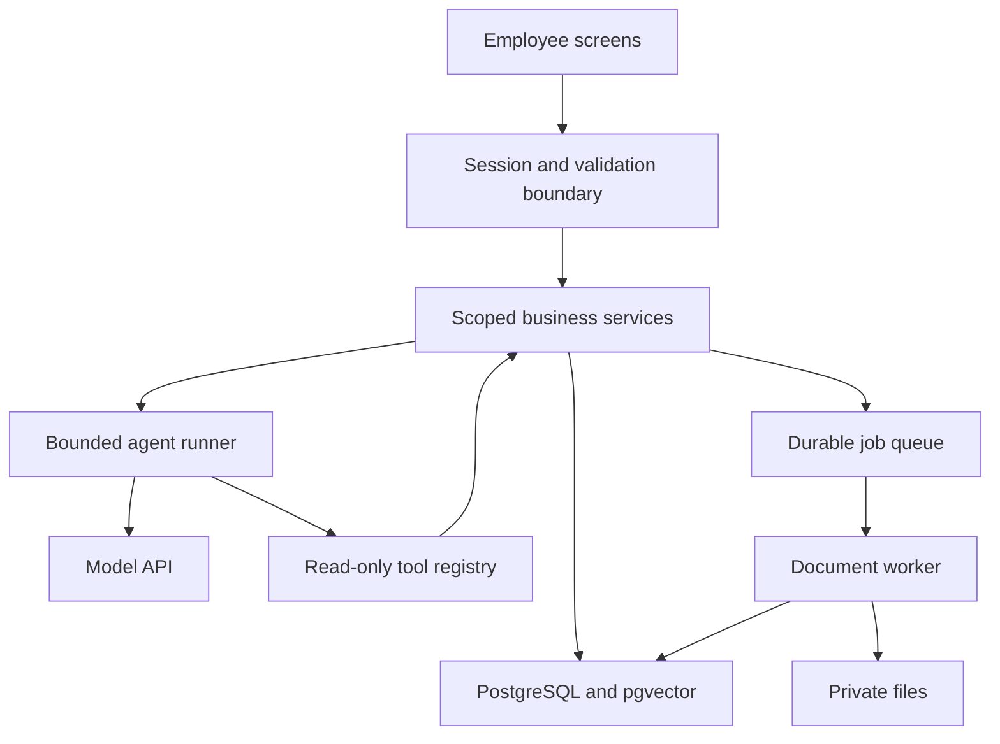

# System architecture

Owner: Issue #2 — Document system architecture. Prerequisite: #1.
Source: original guide §§7–8, 10–16, 20. Status: planned design, not implemented.

## 1. The main idea

Use one repository with a Next.js web application and a separate worker entry point. PostgreSQL stores business state and document vectors. The browser presents information; trusted server code checks permissions and performs operations. AI proposes information-gathering steps and drafts; employees authorize business actions.

Example: clicking Create ticket sends validated input to a server boundary. That boundary identifies the employee, verifies workspace membership, calls the ticket service, writes scoped database records, and returns a safe result. Later, the AI tool calls the same service rules instead of bypassing them.

## 2. Components and responsibility

| Component | Purpose | Introduced |
|---|---|---|
| Next.js App Router, React, TypeScript | Pages, forms, layouts, HTTP boundaries, shared types | #5 |
| Tailwind CSS | Responsive styling and consistent controls | #5 |
| Zod or equivalent runtime schemas | Validate untrusted inputs and tool output | #7 onward |
| PostgreSQL + Prisma | Relational storage, scoped queries, migrations | #7 foundation; #11 business records |
| Better Auth | Guide's preferred authentication/session and organization capability | #7–#9 |
| Private S3-compatible storage | Original uploaded files outside database rows | #17 |
| Redis + BullMQ and Node worker | Durable ingestion and retries | #18 |
| Embeddings API + pgvector | Search passages by semantic meaning inside PostgreSQL | #19 |
| OpenAI SDK and Responses API | Server-side generation and tool requests | #22–#24 |
| GitHub Actions | Repeatable applicable checks on pull requests | #6, expanded later |
| Vitest / Playwright | Service and browser verification | Harness #6, cases with features, broader suite #27 |

Better Auth is the reference design choice, not a claim that it is already installed. Verify its current generated schema and APIs in #7. Record any deliberate replacement before changing identity design.

## 3. Connected architecture

The model requests a named tool; backend code decides whether to execute it. No unrestricted SQL, arbitrary URL fetching, booking mutation, or email sending is exposed. PostgreSQL remains authoritative even when Redis stores job coordination state.

## 4. Folder ownership

| Path | What belongs here | Example |
|---|---|---|
| `src/app/` | Routes, layouts, pages and HTTP handlers | Ticket route |
| `src/components/ui/` | Reusable controls | Button, dialog, input |
| `src/features/` | Feature-specific UI | Ticket conversation panel |
| `src/server/auth/` | Sessions, membership and permission checks | Require workspace member |
| `src/server/services/` | Business rules and transactions | Create task, approve action |
| `src/server/repositories/` | Scoped database queries | Load customer by organization and ID |
| `src/server/ai/` | Model adapter, prompts, tools, runner | Investigate ticket |
| `src/server/knowledge/` | Extraction, chunking and retrieval | Find policy passages |
| `src/server/jobs/` | Queue definitions and processors | Ingest document |
| `src/server/storage/` | Authorized private file access | Issue scoped download |
| `src/lib/` | Safe shared schemas and utilities | Ticket input schema |
| `worker/index.ts` | Worker process startup | Register ingestion processor |
| `prisma/` | Schema, migrations and seed | Workspace seed |
| `tests/` and `evals/` | Deterministic checks and versioned AI cases | Isolation test, missing-policy scenario |

Create folders when their owning issue needs them. Server-only modules must not be imported into browser code. A Next.js build does not automatically establish the worker's build/run process; test that separately in #18.

## 5. Three execution paths

### Ordinary business request

Session → verified membership → input validation → action permission → service → scoped query/transaction → audit event → response. Server-rendered pages can call services directly; they need not call their own HTTP endpoints. Mutations still need the same protections.

### Knowledge ingestion

Owner/manager uploads a permitted file. Store it privately and persist Pending work. A worker extracts text, chunks it, generates embeddings, and atomically marks a complete version Ready. A failed job leaves a visible error; retries do not duplicate chunks. Use a pending-job/outbox reconciliation mechanism so a failure between database write and queue submission cannot lose accepted work.

### AI investigation and approved action

Start a persisted run from a ticket. Retrieve permitted evidence, call the model within configured budgets, validate output, and store proposals. A separate approval request verifies exact payload/version, current permissions and context, and executes one business effect transactionally. Investigation cannot approve itself.

## 6. HTTP boundary conventions

These are proposed contracts from guide §10, not existing endpoints.

| Endpoint family | Responsibility | Owning issues |
|---|---|---|
| `/api/customers` and `/:id` | Scoped list, create, detail, edit/archive | #12 |
| `/api/tickets`, `/:id`, `/:id/messages` | Ticket CRUD, assignment/status, conversation | #13–#14 |
| `/api/tasks`, `/:id` | Follow-up task lifecycle | #15 |
| `/api/documents`, `/:id` | Upload registration, status, authorized access/archive | #17–#21 |
| `/api/knowledge/search` | Scoped evidence retrieval | #20 |
| `/api/agent-runs`, `/:id` | Start and inspect investigation | #24 |
| `/api/action-proposals/:id/approve`, `/reject`, `PATCH /:id` | Exact-version review and execution | #25 |

Return a stable error code, safe message, optional field errors, and request ID. Distinguish invalid input, authentication, permissions, missing records, stale versions, rate limits, and provider failure. Lists require pagination and maximum page sizes. Cookie-based mutations require origin/CSRF protection.

## 7. Operational rules

Keep secrets server-side. Minimize data sent to models and redact logs. Use synthetic public demo data. Enforce upload, concurrency, token, time, and spending limits. Only Ready active sources participate in retrieval. Show recorded tool calls/results, not purported hidden model thoughts.

Poll persisted run/document status initially. Use durable worker execution before deployment where request time limits require it. Keep manual support workflows independent of AI availability.

Web hosting, worker hosting, database region, parser choice, package versions, embedding dimensions and model IDs are implementation decisions, not fixed here. Vercel and a persistent worker host are candidates; verify limits and compatibility in #29.

## 8. Issue #2 completion

- Trace one manual request, one upload job, and one approved AI action through the design.
- Explain where permission checks and transactions occur.
- Confirm the worker has a separate runtime and AI cannot directly mutate records.
- Review folder responsibilities against #1 scope and #3 data design.
- Run documentation/link checks. Application tests are N/A if no scaffold exists.

Next: [database design](database-design.md), Issue #3.
